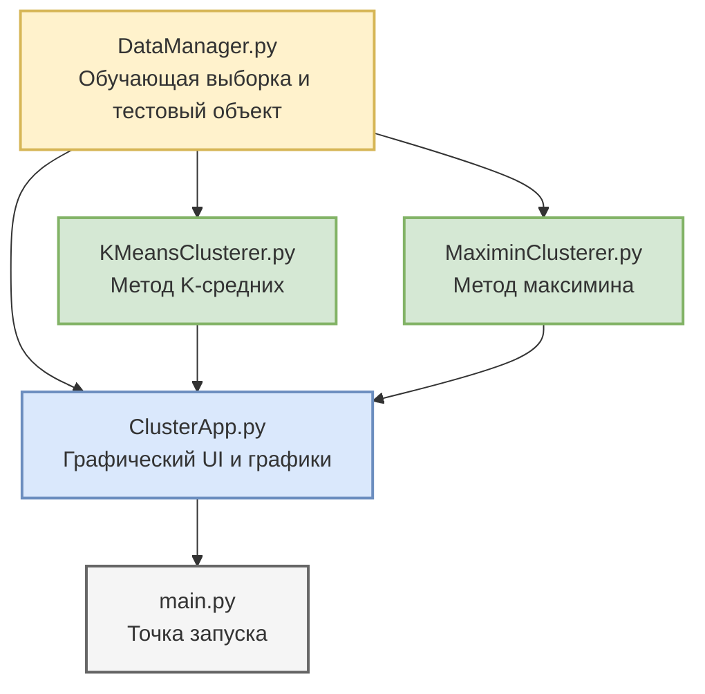

# Кластеризация товаров магазина электроники

Кроссплатформенное десктопное приложение на **Python 3** с графическим интерфейсом на **Tkinter** и аналитической визуализацией на **Matplotlib**. Программа автоматизирует кластеризацию товаров магазина электроники по двум признакам (**цена** и **количество продаж в месяц**) и распознавание нового товара.

Проект разработан как демонстрационная лабораторная работа по дисциплине **«Методы распознавания образов и поддержки принятия решений»**. В приложении последовательно реализованы и сравнены два классических подхода к кластеризации:
1. **Метод K-средних** (итеративная оптимизация центроидов кластеров).
2. **Метод максимина** (выбор центров кластеров как наиболее удалённых реальных объектов выборки).

---

## Архитектура и структура проекта

```text
cluster-lab/
├── DataManager.py             # Исходные данные: обучающая выборка и объект для распознавания
├── KMeansClusterer.py         # Реализация метода K-средних
├── MaximinClusterer.py        # Реализация метода максимина
├── ClusterApp.py              # Графический интерфейс
├── main.py                    # Точка входа 
├── requirements.txt           # Зависимости проекта
├── .gitignore                 # Исключения для Git
└── README.md                  # Документация проекта
```

### Диаграмма взаимодействия модулей



---

## Математическая постановка задачи

Каждый товар описывается **вектором из 2 признаков**:

| Признак | Описание | Единица измерения |
| :---: | :--- | :---: |
| **X1** | Цена товара | тыс. руб. |
| **X2** | Количество продаж | шт./мес |

### Математические этапы

1. **Стандартизация признаков (z-оценка):**  
   Для устранения разницы в масштабах осей (цена меняется от 0.8 до 122, продажи — от 10 до 980) все признаки приводятся к единому масштабу по формуле:  
   $$x_{std} = \frac{x - \mu}{\sigma}$$

2. **Метод K-средних:**  
   * Задаётся число кластеров $k = 3$ и случайно выбираются начальные центроиды.  
   * На каждой итерации каждая точка относится к ближайшему центроиду:  
     $$\ell_i = \arg\min_k \|x_i - c_k\|^2$$
   * Центроиды пересчитываются как среднее арифметическое точек своего кластера:  
     $$c_k = \frac{1}{|S_k|} \sum_{x \in S_k} x$$
   * Процесс продолжается до сходимости (смещение центров < $\varepsilon$).

3. **Метод максимина:**  
   * Первый центр — точка с максимальной суммой расстояний до остальных:  
     $$c_1 = \arg\max_i \sum_j \|x_i - x_j\|$$
   * Каждый следующий центр — точка с максимальным расстоянием до ближайшего из уже выбранных, при условии, что оно превышает порог:  
     $$c_{new} = \arg\max_i \min_{c \in C} \|x_i - c\|$$
   * Процесс продолжается до достижения порога или предельного числа кластеров.

---

## Ключевые возможности приложения

* **Двойная визуализация:** Одновременное отображение результатов кластеризации методами K-средних и максимина в двух графиках Matplotlib с согласованной цветовой схемой кластеров.
* **Интерактивное распознавание:** Возможность задать характеристики нового товара (цену и продажи) через форму ввода — оба алгоритма определят, к какому кластеру он относится.
* **Информационная панель:** Автоматический вывод состава каждого кластера, названия сегмента и результата распознавания тестового товара.
* **Таблица обучающей выборки:** Наглядное отображение всех 33 объектов с их признаками.
* **Согласованность кластеров:** Центроиды упорядочиваются по возрастанию цены, благодаря чему нумерация и цвета кластеров совпадают на обоих графиках.

---

## Установка и запуск

### Системные требования
* **Python 3.9** или выше
* Операционная система: Windows, macOS, Linux

### Инструкция по запуску

1. Склонируйте репозиторий с проектом:
   ```bash
   git clone <URL_ВАШЕГО_РЕПОЗИТОРИЯ>
   cd cluster-lab
   ```

2. Создайте и активируйте изолированное виртуальное окружение:
   ```bash
   # Для Windows:
   python -m venv .venv
   .venv\Scripts\activate

   # Для Linux / macOS:
   python3 -m venv .venv
   source .venv/bin/activate
   ```

3. Установите обязательные внешние зависимости:
   ```bash
   pip install -r requirements.txt
   ```

4. Запустите приложение:
   ```bash
   python main.py
   ```

---

